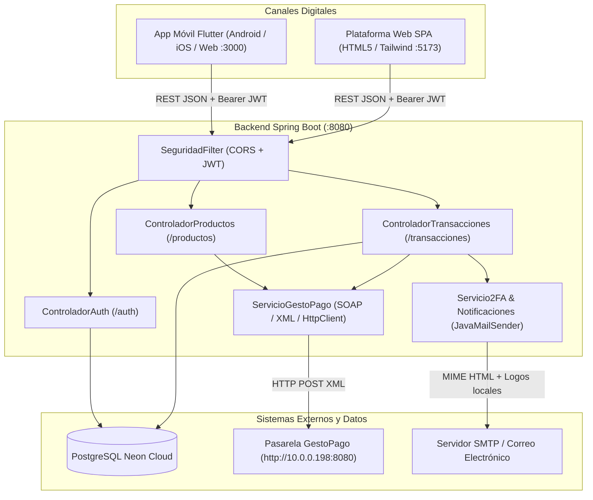
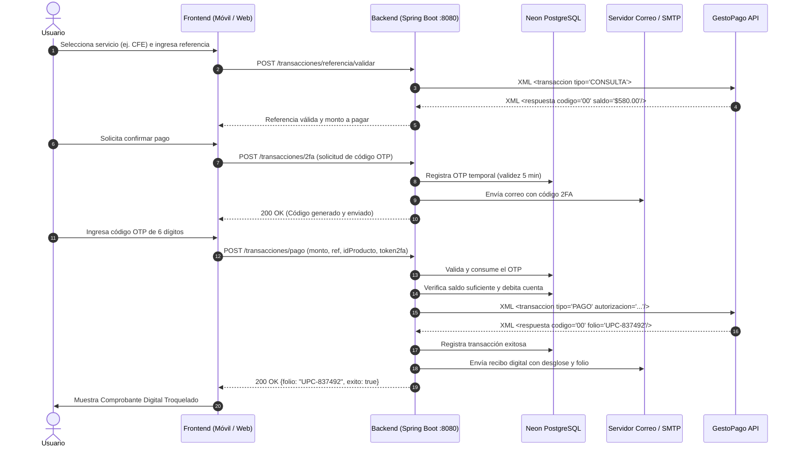

# Documento Técnico de Arquitectura y Servicios
## Plataforma de Pagos de Servicios - GestoPago (Banca Digital)

---

## 1. Visión General del Sistema

La **Plataforma de Pagos de Servicios GestoPago** es un ecosistema omnicanal compuesto por:
1. **Solución Móvil Flutter (`frontend/`):** Diseñada bajo la estética *Apple Wallet & Glassmorphism* con paleta Lila/Violeta (`#7C3AED`, `#EDE9FE`), Tarjeta Holográfica 3D, Hoja Deslizable inferior (*Curved Bottom Sheet*), carrusel Stories de servicios frecuentes y **Barra de Navegación Inferior Flotante (Floating Glass Dock)**.
2. **Solución Web SPA (`frontend-web/`):** SPA responsiva construida con Tailwind CSS, HTML5 semántico y JavaScript ES6 modular, con iluminación difusa ambiental (*ambient mesh glow*) y comprobantes troquelados con impresión a PDF.
3. **Backend REST API (`src/`):** Microservicio en Spring Boot 3.x con Java 17, seguridad mediante Spring Security y JWT stateless, integración SOAP/XML con el simulador de pasarela GestoPago, autenticación de doble factor (2FA) por correo electrónico y persistencia en PostgreSQL Neon vía Flyway.



---

## 2. Arquitectura de Seguridad y Flujo de Autenticación (2FA)

La plataforma implementa seguridad bancaria en múltiples capas:
1. **Filtro CORS de Alta Prioridad:** Permite orígenes autorizados (`http://localhost:3000`, `http://localhost:5173`, etc.) con soporte para credenciales y encabezados de autorización.
2. **Tokens JWT:** Generación de JWT firmados con clave secreta criptográfica tras la validación de credenciales (correo y contraseña cifrada con BCrypt).
3. **Doble Factor de Autenticación (2FA Dinámico):** Antes de ejecutar un pago de servicios, se genera un código OTP numérico de 6 dígitos con vigencia de 5 minutos, remitido directamente al correo registrado del cuentahabiente.

### Diagrama de Secuencia: Flujo de Pago con 2FA



---

## 3. Catálogo de Endpoints REST

| Método | Endpoint | Rol / Seguridad | Descripción |
| :--- | :--- | :--- | :--- |
| `POST` | `/auth/login` | Público | Autenticación de clientes. Devuelve JWT y perfil inicial. |
| `POST` | `/auth/registro` | Público | Registro de nuevos usuarios con cuenta digital y saldo inicial. |
| `GET` | `/productos` | Público / Bearer | Catálogo oficial de servicios agrupados por `tipoFront` (Telefonía, CFE, Agua, etc.). |
| `GET` | `/cuentas/buscar` | Bearer Token | Obtención de la cuenta activa, saldo disponible y número enmascarado. |
| `POST` | `/transacciones/referencia/validar` | Bearer Token | Consulta previa del saldo/vigencia de la referencia con GestoPago. |
| `POST` | `/transacciones/2fa` | Bearer Token | Emisión de código OTP dinámico enviado al correo registrado. |
| `POST` | `/transacciones/pago` | Bearer Token | Ejecución del débito bancario y confirmación del pago en GestoPago. |
| `GET` | `/transacciones/historial` | Bearer Token | Historial paginado de movimientos y comprobantes digitales. |

---

## 4. Mapeo de Servicios GestoPago XML y Assets Gráficos

El simulador de GestoPago expone productos mediante el método `getProductList.do` en formato XML plano:
```xml
<product 
    idServicio="1" 
    idProducto="101" 
    servicio="CFE" 
    producto="CFE Suministro Básico" 
    precio="0.00" 
    legend="Ingrese su número de servicio de 12 dígitos"/>
```

Dado que el protocolo de GestoPago no transporta recursos multimedia ni URLs de imágenes:
- El backend y los frontends asocian internamente cada marca (`CFE`, `TELCEL`, `TELMEX`, `MOVISTAR`, `AT&T`, `NATURGY`, `TOTALPLAY`, `IZZI`, `SKY`, `AGUA`, `TELEVIA`) a una suite corporativa de logotipos vectoriales de alta definición generados y alojados localmente en:
  - Móvil: `frontend/assets/logos/*.png` y fallback dinámico HTTP.
  - Web: `frontend-web/img/logos/*.png`.
  - Backend (Emails): `src/main/resources/static/logos/*.png`.

---

## 5. Diseño y Distribución de Interfaces

### 5.1 Solución Móvil Flutter (`frontend/`)
- **Header VIP:** Saludo personalizado, avatar de usuario y número de cuenta bancaria.
- **Apple Card 3D Holográfica:** Tarjeta con gradiente cuádruple violeta/lila, iluminación difusa, toggle de visibilidad del saldo (`$ ••••.••`) y chip NFC metálico.
- **Action Pills:** Botones tipo cápsula flotante con sombra suave ("Pagar", "Recargas", "Historial").
- **Hoja Deslizable (Curved Bottom Sheet):** Contenedor blanco con curvas de 32px que contiene el carrusel de Stories de servicios frecuentes y los movimientos recientes.
- **Barra de Navegación Inferior Flotante (Floating Glass Dock):** Dock curva con bordes cristalinos (`0xFF1E1035`), indicadores luminosos lila y acceso instantáneo a Inicio, Servicios, Historial y Perfil.
- **Catálogo en Cuadrícula (Grid 2 columnas):** Tarjetas con logo central de 56px, badge de tipo de referencia y botón de acción directa.
- **Comprobante Digital Troquelado:** Diseño de ticket físico con corte punteado, folio digital UPC y desglose bancario.

### 5.2 Solución Web SPA (`frontend-web/`)
- **Estilo Glassmorphism:** Fondo degradado oscuro con orbes luminosos difusos (*Ambient Mesh Glow*).
- **Dashboard Dual:** Tarjeta bancaria interactiva a la izquierda y carrusel deslizable horizontal de Stories a la derecha.
- **Catálogo Responsivo:** Cuadrícula con buscador reactivo, filtros por tipo de servicio y botones interactivos con resplandor (*Glow*).
- **Modal de 2FA y Ticket Digital:** Impresión directa a PDF del recibo con folio bancario.
